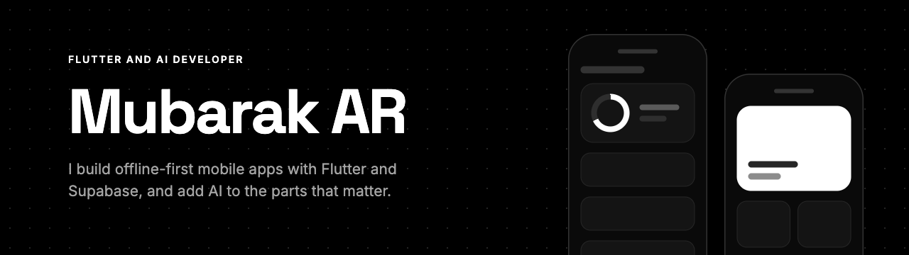
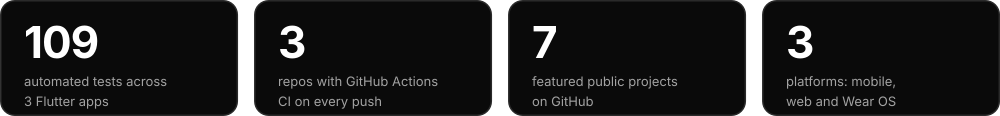
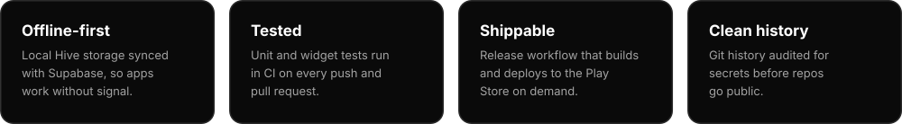
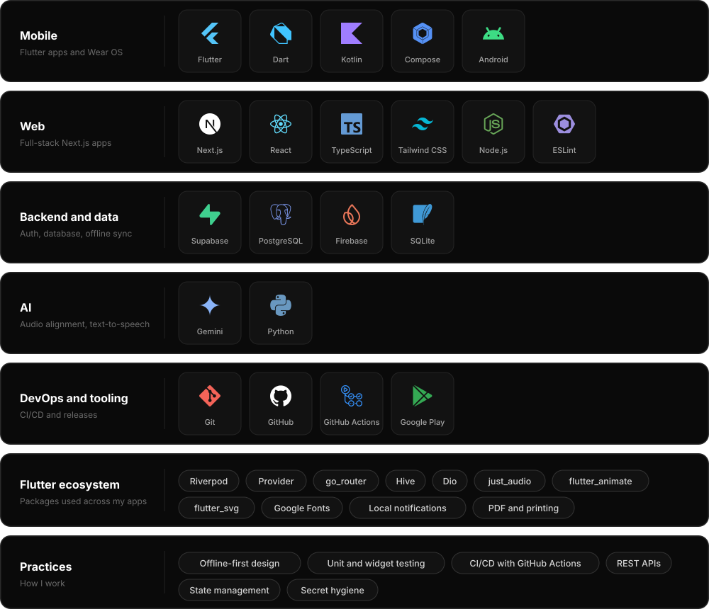

  

  <b>Flutter and AI developer</b> building offline-first mobile apps with Flutter and Supabase. 
  Open to Flutter, mobile and AI engineering roles.

  
  
  

  

## About

I'm a full-stack developer who ships on three platforms: **mobile** with Flutter, **web** with Next.js and **Wear OS** with Kotlin. Most of my work is in two areas: Quran education tools (reading, memorization tracking and revision for Hifz institutions) and business apps such as PG and room rental management.

- I design for **bad connectivity first**: local storage with Hive or SQLite, synced to Supabase.
- I add **AI where it removes real work**, for example Gemini-assisted audio alignment for Quran recitation.
- I treat repos as products: **tests, CI and clear READMEs** on every project I want people to read.
- I'm a Hafiz of the Quran, and that discipline carries into how I write code.

## Featured projects

 

  Live CI status:
  
  
  

## How I build

  

## Tech stack

  

## What I'm working on

- Hardening my public repos: unit and widget tests, GitHub Actions CI and cleaner READMEs.
- Improving AI audio alignment for Quran recitation in [holyquran-ai](https://github.com/mubarakar95/holyquran-ai).
- Extending [huffaz-app](https://github.com/mubarakar95/huffaz-app), an offline-first revision tracker for Hifz institutions.

## Let's connect

If you're hiring for Flutter, mobile or AI work, I'd like to hear from you:
[LinkedIn](https://linkedin.com/in/mubarakar95) · [mubarakar95@gmail.com](mailto:mubarakar95@gmail.com)
